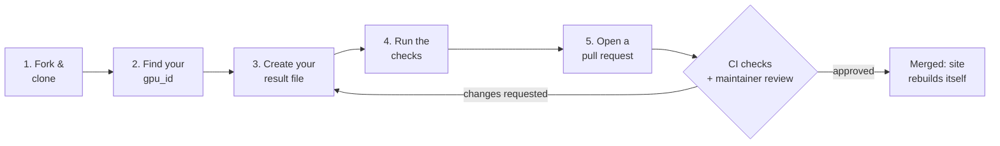

# Contributing to Open GPU Benchmarks

Thanks for helping build an open, reviewable GPU comparison. Every number on the
dashboard comes from a small YAML file in this repository. **The easiest way
to add a result is a [Benchmark result issue](https://github.com/MattyStacks/open-gpu-benchmarks/issues/new?template=benchmark.yml):**
fill in the form and a bot writes the file and opens the pull request for you
(see [Submit through an issue](docs/COMMUNITY_SUBMISSIONS.md#submit-through-an-issue)).
Already have a result file, such as an Open GPU Benchmarker export? Attach it to a
[Benchmark result (file) issue](https://github.com/MattyStacks/open-gpu-benchmarks/issues/new?template=benchmark_file.yml)
(see [Submit a result file](docs/COMMUNITY_SUBMISSIONS.md#submit-a-result-file)).
Submitting is the CC BY 4.0 agreement; there's no box to tick.
The pull request steps below are for bulk or scripted uploads, raw captures,
and anything the form doesn't cover.

## What do you want to do?

| I want to...                              | Go to                                                  |
| ----------------------------------------- | ------------------------------------------------------ |
| **Add my FPS results** (most people)      | [Open a Benchmark result issue](https://github.com/MattyStacks/open-gpu-benchmarks/issues/new?template=benchmark.yml) |
| Submit a result file I already have       | [Open a Benchmark result (file) issue](https://github.com/MattyStacks/open-gpu-benchmarks/issues/new?template=benchmark_file.yml) |
| Add many results, or results with raw captures | [Submit a result in 5 steps](#submit-a-result-in-5-steps) (pull request) |
| Add a card, laptop, or handheld that isn't in the catalog | [Adding a card, laptop, or handheld](#adding-a-card-laptop-or-handheld) |
| Fix or remove a result I submitted        | [Fixing or removing a result](#fixing-or-removing-a-result) |
| Understand a failed check on my PR        | [Reading a failed check](#reading-a-failed-check)      |
| Change the dashboard, scripts, or docs    | [Other contributions](#other-contributions)            |

## Submit a result in 5 steps



You need Git, Python 3.11+, and a GitHub account. No other tooling.

> **Your results become public data.** Benchmark data here is released under
> [CC BY 4.0](data/LICENSE). By submitting a result, you agree that:
>
> - anyone can use it for anything: copy it, change it, chart it, use it
>   commercially, or train AI on it;
> - sites that use it must credit Open GPU Benchmarks and link back, so
>   readers can find the source, report problems, and contribute (AI models
>   credit it in their documentation, not in every answer);
> - your own credit (your username, or the source you found) stays with the
>   result on this site, in the data, and in the Git history;
> - it can't be taken back once it's out.
>
> Only include what you're happy to make public. The details, in plain
> English, are in
> [Your results become public data](docs/COMMUNITY_SUBMISSIONS.md#your-results-become-public-data), and
> the [license page](https://opengpubenchmarks.com/license/) explains what
> counts as reasonable attribution.

### Step 1: Fork and clone

Fork the repository on GitHub, clone your fork, and create a branch:

```powershell
git clone https://github.com/<your-github-username>/open-gpu-benchmarks.git
cd open-gpu-benchmarks
git checkout -b add-rtx-4070-super-cyberpunk
python -m venv .venv
.venv\Scripts\Activate.ps1
python -m pip install -r requirements.txt
```

That's PowerShell on Windows. On macOS, Linux, or WSL, make and turn on the
environment with:

```bash
python3 -m venv .venv
source .venv/bin/activate                # run it with source, not ./ or bash
python -m pip install -r requirements.txt
```

This creates a project-only Python environment in `.venv` (gitignored) so the
dependencies don't touch your global Python. Your prompt shows `(.venv)` while
it's active. Next time, open a terminal in the repo and run only the activate
line. When you're done, run `deactivate` (same on every OS) or close the
terminal. If PowerShell refuses to run `Activate.ps1`, run
`Set-ExecutionPolicy -Scope CurrentUser RemoteSigned` once.

### Step 2: Find your `gpu_id`

Every product in the catalog has one file under [data/gpus/](data/gpus/README.md).
**The file name, without `.yaml`, is your `gpu_id`.**

```text
data/gpus/
└── desktop/
    └── nvidia/
        └── rtx_5080_16gb_fe.yaml     <- gpu_id: rtx_5080_16gb_fe
```

The ID names the exact product you tested, including its memory size and, for
desktop cards, its board maker. An 8 GB and a 16 GB card, or an MSI and an ASUS
version of the same GPU, have different IDs, and their results are never mixed.

Current IDs:

| Form factor | IDs |
| ----------- | --- |
| desktop  | `rtx_5080_16gb_fe` |

Your product isn't listed? Add it first. See
[Adding a card, laptop, or handheld](#adding-a-card-laptop-or-handheld). You
can add the catalog entry and your result in the same pull request.

### Step 3: Create your result file

Create **one file per game run** in your product's folder:

```text
data/
└── community/
    └── rtx_5080_16gb_fe/                      <- folder name = gpu_id
        ├── result_20261003_cyberpunk_2077.yaml     <- your file
        └── raw/
            └── cyberpunk_1440p.csv                  <- optional capture (recommended)
```

The file name has three parts. It doesn't include your name:

```text
result_20261003_cyberpunk_2077_2.yaml
       └──┬───┘ └─────┬──────┘ ┬
       date run    game_id    repeat
       (YYYYMMDD)  (from      (only if you already
                   data/      have a file for that
                   games.yaml) day and game)
```

**Is your game in [`data/games.yaml`](data/games.yaml)?** Every result names
its game by the `id` listed there, such as `cyberpunk_2077`. If your game or
benchmark isn't listed yet, add it in the same pull request. It needs four
lines (`id`, `name`, `type`, `year`). Add `steam_appid` or `url` too when the
game has one; they're optional because not every game is on Steam. See
[Adding a game or benchmark](docs/COMMUNITY_SUBMISSIONS.md#adding-a-game-or-benchmark).

Your username is optional. Add `submitted_by: yourname` to the file if you want
the dashboard to show "@yourname"; leave it out and the run shows as
"Anonymous". The data then carries no name, but GitHub still shows who opened
the pull request; see
[Anonymous by default](docs/COMMUNITY_SUBMISSIONS.md#anonymous-by-default).

Found the result in a video, review, or post instead? That's welcome too. Start
from `templates/community_found_result.yaml` and say where you found it; see
[Submitting a result you found](docs/COMMUNITY_SUBMISSIONS.md#submitting-a-result-you-found).

Pick **one** way to create the file:

**Option A: copy the template (works for any capture method)**

```powershell
Copy-Item templates/community_submission.yaml `
  data/community/rtx_5080_16gb_fe/result_20261003_cyberpunk_2077.yaml
```

Then edit the values. The examples below show what to fill in.

**Option B: import Cyberpunk 2077's built-in benchmark runs**

```powershell
python scripts/import_cyberpunk.py --gpu-id rtx_5080_16gb_fe --dry-run
python scripts/import_cyberpunk.py --gpu-id rtx_5080_16gb_fe
```

This writes the day's runs from the game's `benchmarkResults` folder into one
file, one `result` item per run, and skips runs it has already imported. See
[docs/CYBERPUNK_BENCHMARK.md](docs/CYBERPUNK_BENCHMARK.md).

**Option C: generate it from a PresentMon or MangoHud CSV**

```powershell
python scripts/parse.py capture.csv `
  --gpu-id rtx_5080_16gb_fe `
  --game-id cyberpunk_2077 `
  --resolution 1440p `
  --graphics-preset Ultra `
  --os windows `
  --os-detail "Windows 11 Pro 24H2"
```

This writes the correctly named file for you. It refuses an ID that isn't in
the catalog and takes the form factor from the catalog entry. `--os` is
`windows` or `linux`. If you leave it out, a MangoHud capture means `linux` and a
PresentMon capture means `windows`, and the script prints which one it picked.
For MangoHud logs it also copies the kernel and driver from the log header. It
does not know the rest of your hardware, so open the file afterwards and add the
`system:` details (CPU, memory, driver, and the OS details such as `distro` or
`proton`) and any extra resolution/preset profiles by hand. Copy your
CSV into the product's `raw/` folder and point `proof.raw_log` at it, for
example `raw/cyberpunk_1440p.csv`.

### Step 4: Run the checks

```powershell
python scripts/validate.py
python scripts/build.py
python scripts/test_build.py
```

`validate.py` lists **every** problem at once. Each line starts with `error:`
(blocks your PR) or `warning:` (worth improving), then the file, then the rule
name in brackets, then a link to the rule's explanation:

```text
error: data/community/rtx_5080_16gb_fe/result_20261003_cyberpunk_yourname.yaml: [result-impossible] result[0] p1_low 80 > avg_fps 60 is impossible
    See https://github.com/MattyStacks/open-gpu-benchmarks/blob/main/docs/COMMUNITY_SUBMISSIONS.md#result-impossible
```

Fix every error. You can check one part at a time with
`python scripts/validate.py catalog` or `python scripts/validate.py results`.

### Step 5: Open a pull request

```powershell
git add data/community/rtx_5080_16gb_fe
git commit -m "Add RTX 4070 Super FE Cyberpunk 2077 results"
git push -u origin add-rtx-4070-super-cyberpunk
```

Open the pull request on GitHub and include:

- [ ] Product, game, and game version
- [ ] Resolution and graphics preset(s) you ran
- [ ] Anything unusual (overclock, undervolt, power limit, mods)
- [ ] How you captured the numbers, as `proof.method` (PresentMon is
  recommended; CapFrameX, FrameView, MSI Afterburner, AMD Adrenalin, MangoHud,
  OCAT, an in-game benchmark, or a 3DMark result link are also accepted, and
  3DMark runs can start from `templates/community_steel_nomad.yaml`)

Opening the pull request means you agree to release what you submit under
[CC BY 4.0](data/LICENSE): the numbers become public data anyone can use for
anything, as long as they credit Open GPU Benchmarks. The pull request
template asks you to confirm it.

GitHub runs the same checks you just ran, as four separate checks (see
[Reading a failed check](#reading-a-failed-check)). A maintainer then reviews
the evidence. After merge, the site rebuilds automatically. You do not need to
touch `site/api/`, which is generated.

## Examples

The laptop and handheld examples use IDs that aren't in the catalog yet; add
your product first (see [Adding a card, laptop, or handheld](#adding-a-card-laptop-or-handheld)).

### Minimal file (only what's required)

This is the smallest file that passes validation, and it's anonymous. It warns
that there's no evidence, and the dashboard labels it "Unverified", so add a
raw capture or a summary link when you can.

```yaml
gpu_id: rtx_5080_16gb_fe   # must equal the folder name
game_id: cyberpunk_2077
date: '2026-10-03'         # the day you ran it, quoted; same as the file name
result:
  - resolution: 1440p
    graphics_preset: Ultra
    avg_fps: 98.4
    p1_low: 77.1                 # 1% low; can't be higher than avg_fps
system:
  os: windows                    # windows or linux
proof:
  method: presentmon             # the capture tool you used
```

Frame generation and upscaling are off unless you say otherwise. Leave them off
when you benchmark; see [Upscaling](docs/COMMUNITY_SUBMISSIONS.md#upscaling).

### Result you found in a video or review

You don't need permission, only the link. The names and links here are
placeholders.

```yaml
gpu_id: rtx_5080_16gb_fe
game_id: cyberpunk_2077
date: '2026-10-13'   # the day the source was published; same as the file name
credit:
  source_url: https://example.com/example-creator/gpu-review   # required
  name: Example Creator                                        # optional
result:
  - resolution: 1440p
    graphics_preset: Ultra
    avg_fps: 74.0
system:
  os: windows
proof:
  method: other                  # or the tool the source says it used
```

### Desktop with raw capture (recommended)

One run, two profiles. Each profile starts with its own `-`. This one adds the
optional username and machine details.

```yaml
gpu_id: rtx_5080_16gb_fe
submitted_by: mattystacks        # optional; shown as @mattystacks
benchmark_type: game
game_id: cyberpunk_2077
date: '2026-10-03'
version: "2.12"
frame_generation: false
device_name: Ryzen 7 7800X3D test bench
overclocked: false
result:
  - resolution: 1440p            # first profile
    graphics_preset: Ultra RT
    avg_fps: 79.1
    p1_low: 65.0
    p5_low: 68.2                 # optional, from PresentMon
  - resolution: 1080p            # second profile: new dash, same indent
    graphics_preset: Ultra RT
    avg_fps: 103.4
    p1_low: 84.7
system:
  cpu: AMD Ryzen 7 7800X3D
  memory_gb: 32                  # optional, a number of GB
  memory_type: DDR5-6000         # optional, type and speed
  memory_channels: 2             # optional, 1 single, 2 dual, 4 quad
  power_mode: Performance
  display_mode: direct
  driver: "561.09"
  os: windows                    # required: windows or linux, lowercase
  os_detail: Windows 11 Pro 24H2
  resizable_bar: true
proof:
  method: presentmon                       # required: the capture tool you used
  raw_log: raw/Cyberpunk_4070S_1440p.csv   # relative to this product's folder
  format: presentmon_summary
```

### Laptop (power matters)

Laptop results are grouped by GPU power, so always include `gpu_power_w`.
Validation only warns if it's missing, but your result can't be compared
properly without it. Use your laptop model's catalog ID, and add the laptop to
the catalog first if it isn't there yet. Laptop system RAM goes in
`system.memory_gb` (a number), not in the ID, because it can usually be upgraded.

```yaml
gpu_id: rtx_4070_laptop_8gb_lenovo_legion_pro_5_gen8
game_id: baldurs_gate_3          # not in data/games.yaml yet: add it in the same pull request
version: "4.1.1"
frame_generation: false
device_name: Lenovo Legion Pro 5
gpu_power_w: 115                 # the TGP your laptop actually runs at
overclocked: false
result:
  - resolution: 1080p
    graphics_preset: Ultra
    avg_fps: 88.0
    p1_low: 61.5
system:
  cpu: Intel Core i7-13700HX
  memory_gb: 16
  memory_type: DDR5-5600
  power_mode: Performance
  display_mode: dGPU only        # MUX switch state
  driver: "560.94"
  os: windows
  os_detail: Windows 11 Home 23H2
proof:
  method: presentmon
  raw_log: raw/bg3_1080p.csv
  format: presentmon_summary
```

### Handheld, summary only (no raw capture)

No CSV? Say where the numbers came from with `proof.summary_source`. The
dashboard labels these as summary-only.

```yaml
gpu_id: steam_deck_oled_16gb
game_id: cyberpunk_2077
date: '2026-10-03'
version: "2.12"
frame_generation: false
result:
  - resolution: 800p
    graphics_preset: Low
    avg_fps: 41.0
    p1_low: 33.0
system:
  power_mode: 15W
  os: linux                      # SteamOS is Linux; the distro goes in its own field
  distro: SteamOS
  distro_version: "3.6"
  runtime: proton
  session: gamescope
proof:
  method: other
  summary_source: Steam Deck performance overlay, 3-minute run in the market area
```

## What's required

| Field                                          | Required? | Notes                                                   |
| ---------------------------------------------- | --------- | ------------------------------------------------------- |
| `gpu_id`                                       | **Yes**   | Must match the folder name and a catalog file name under `data/gpus/` |
| `game_id`                                      | **Yes**   | The game's `id` in `data/games.yaml`; add a new game there in the same pull request |
| `date`                                         | **Yes**   | Quoted `'YYYY-MM-DD'`, the same day as the file name; for a result you found, the publish date. See [date and time](docs/COMMUNITY_SUBMISSIONS.md#date-and-time) |
| `result[].time`                                | Optional  | Quoted local 24-hour `'HH:MM'` or `'HH:MM:SS'`; no time zone |
| `result` list                                  | **Yes**   | At least one entry; every entry starts with `-`         |
| `result[].resolution`, `graphics_preset`       | **Yes**   | Use `graphics_preset`, never `settings`                 |
| `result[].avg_fps`                             | **Yes**   | Average FPS                                             |
| `result[].p1_low`                              | Depends   | 1% low; can't exceed `avg_fps`. Required for PresentMon, CapFrameX, FrameView, MSI Afterburner, MangoHud, and OCAT; optional for AMD Adrenalin, in-game benchmarks, 3DMark, and other |
| `credit.source_url`                            | Only for a result you found | The `https://` link where you found it; see [submitting a result you found](docs/COMMUNITY_SUBMISSIONS.md#submitting-a-result-you-found) |
| `proof.method`                                 | **Yes**   | The capture tool: `presentmon` (recommended), `capframex`, `frameview`, `msi_afterburner`, `amd_adrenalin`, `mangohud`, `ocat`, `in_game_benchmark`, `synthetic_benchmark`, or `other`; see [capture methods](docs/COMMUNITY_SUBMISSIONS.md#capture-methods) |
| `frame_generation`                             | Off       | `false` is the default; frame generation runs aren't comparable |
| `upscaling`                                    | Off       | Off by default; set it only with `preset_upscaling: true` when the preset turns it on; see [upscaling](docs/COMMUNITY_SUBMISSIONS.md#upscaling) |
| `system.os`                                    | **Yes**   | `windows` or `linux`, lowercase; Windows and Linux runs are never averaged together |
| `gpu_power_w` (laptops)                        | Warning   | Strongly encouraged                                     |
| `proof.raw_log` or `proof.summary_source`      | Warning   | Raw capture preferred; without any evidence the run shows as "Unverified" |
| `submitted_by`                                 | Optional  | Your GitHub username, shown as @you; leave it out to stay anonymous |
| `credit.name`, `credit.url`                    | Optional  | Who measured a result you found, and their channel      |
| `system` (CPU, memory, driver, power mode)     | Optional  | Share it if you like: reviewers and readers use it      |
| OS details (`os_detail`, `distro`, `kernel`, `mesa`, `proton`, ...) | Optional | Must fit the OS; see [the OS fields](docs/COMMUNITY_SUBMISSIONS.md#operating-system) |

Write every list item on its own `-` line. Inline `[ ]` and `{ }` are rejected.

## Common mistakes

| Mistake | Rule you'll see | Fix |
| ------- | --------------- | --- |
| Folder doesn't match `gpu_id` | `[result-folder]` | Move the file, or correct `gpu_id` |
| Old or made-up ID such as `rtx_4090` | `[result-unknown-gpu]` | Use the exact catalog file name, such as `rtx_5080_16gb_fe` |
| File name isn't `result_YYYYMMDD_<game_id>.yaml` | `[community-filename]` | Rename the file, such as `result_20261003_cyberpunk_2077.yaml` |
| Free-text `game_id: cyberpunk_2077` | `[result-game-id]` | Use `game_id: cyberpunk_2077` |
| `game_id` that isn't in `data/games.yaml` | `[result-unknown-game]` | Fix the spelling, or add the game to `data/games.yaml` in the same pull request |
| `submitted_by` with spaces or other characters a GitHub username can't have | `[community-submitter]` | Fix it, or remove the line to stay anonymous |
| File not named `result_...` | `[result-filename]` | Rename it, or the build would skip it |
| No `date`, or an unquoted `date: 2026-10-03` | `[result-date]` | Add `date: '2026-10-03'`, quoted |
| `date` isn't the file name's day | `[result-date-filename]` | Fix whichever is wrong; one file holds one day |
| An unquoted `time: 14:30` | `[result-time]` | Quote it: `time: '14:30'` |
| Forgot the `-` or repeated `result:` | `[result-field]` or lost entries | One `result:` key, one `-` per profile |
| Used `settings:` | `[result-field] ... missing graphics_preset` | Rename to `graphics_preset` |
| Ran with DLSS/FSR Frame Gen | `[result-frame-generation]` | Re-run with frame generation off |
| Ran with DLSS, FSR, or XeSS upscaling | `[result-upscaling]` | Re-run with upscaling off, or add `preset_upscaling: true` if the preset turned it on |
| `p1_low` bigger than `avg_fps` | `[result-impossible]` | Check you didn't swap the values |
| No `p1_low` from PresentMon, Afterburner, or another frame-time tool | `[result-p1-low-required]` | Copy the 1% low from the tool's summary |
| No `p1_low` from Adrenalin | `[result-no-p1-low]` (warning) | Fine if your tool didn't report one |
| No `p1_low` from an in-game benchmark | `[result-no-p1-low]` (info) | Nothing to fix; it's a note, not a warning |
| A result you found, with no link to where | `[community-credit]` | Add `credit.source_url` |
| No `proof.method`, or an unknown one such as `screenshot` | `[result-proof-method]` | Add `proof.method` with the tool you used (list in the template); use `other` if yours isn't listed |
| Far from the official result | `[community-outlier]` | Re-check the settings, or explain the difference in the PR |
| Wrote `[a, b]` or `{}` | `[yaml-inline]` | One `-` line per item; leave empty fields out |
| No `system.os`, or `os: Windows 11` | `[result-os]` | Set `os: windows` or `os: linux`; put the full name in `os_detail` |
| `proton:` on a Windows run, or `hags:` on a Linux run | `[result-os-field]` | Remove the field, or fix `system.os` |
| `hags: yes` or an unquoted `kernel: 6.8` | `[result-os-field]` | Use `true`/`false` for flags; quote version numbers |

Every rule is explained in
[docs/COMMUNITY_SUBMISSIONS.md](docs/COMMUNITY_SUBMISSIONS.md#what-the-checks-mean)
(results) and [data/gpus/README.md](data/gpus/README.md#what-the-checks-mean)
(catalog).

## How your numbers appear on the dashboard

```text
 your file ─┐
            ├─►  same product ID + game + resolution + preset  ─►  ONE row (averaged)
 other file ┘    (and same laptop power, if a laptop)

 1440p Ultra RT  ─►  its own row         Different memory sizes,
 1080p Ultra RT  ─►  a different row     board makers, and desktop
                                         vs laptop are never combined.
```

Exact machine details stay on each run; the charts show the grouped summary.

## Raw evidence

Raw captures make a result reviewable, so please include one when you can. Put
them inside the same product folder and reference them relative to it:

```text
data/community/rtx_5080_16gb_fe/raw/Cyberpunk_4070S_1440p.csv
                                      └── proof.raw_log: raw/Cyberpunk_4070S_1440p.csv
```

Raw files stay in Git but are not published in the site's JSON.

## Adding a card, laptop, or handheld

Each product gets one file in the catalog. The full rules are in
[data/gpus/README.md](data/gpus/README.md); this is the short version.

1. **Search first.** Look under `data/gpus/` for your product. If it's there,
   use its ID and skip the rest.
2. **Pick the folder:** `data/gpus/<form_factor>/<gpu_vendor>/`.
   - `form_factor` is `desktop`, `laptop`, `handheld`, or `igpu`.
   - `gpu_vendor` is the GPU chip maker: `nvidia`, `amd`, or `intel`. It is
     never the board or device maker.
3. **Build the ID** from the pattern for your form factor:

   | Form factor | Pattern | Example |
   | ----------- | ------- | ------- |
   | desktop  | `<gpu_model>_<vram>gb_<brand>_<product_line>` | `rtx_5060_ti_16gb_msi_ventus_2x` |
   | laptop   | `<gpu_model>_<vram>gb_<oem>_<model>` | `rtx_4070_laptop_8gb_asus_zephyrus_g14_2023` |
   | handheld | `<device>_<chip>_<ram>gb` | `rog_ally_x_z1_extreme_24gb` |

   Lowercase, digits, and underscores only. The memory size must match
   `memory.capacity_gb`.
4. **Find the reference file.** Look in `data/gpus/reference/<gpu_vendor>/`
   for your GPU's shared specs, such as `rtx_5060_ti_16gb.yaml` or
   `z1_extreme.yaml`. If it's there, set `base:` to its file name and only
   write what your product changes or adds. If it's missing, copy
   [catalog_reference.yaml](templates/catalog_reference.yaml) to create it,
   or skip `base` and fill in every section of your product yourself.
5. **Copy the template** for your form factor and name the copy `<id>.yaml`:
   [catalog_desktop.yaml](templates/catalog_desktop.yaml),
   [catalog_laptop.yaml](templates/catalog_laptop.yaml), or
   [catalog_handheld.yaml](templates/catalog_handheld.yaml).
6. **Fill in what you know.** Only five fields are required: `id`,
   `identity.name`, `identity.gpu_vendor`, `classification.form_factor`, and
   `memory.capacity_gb`. A product can inherit any of them from its `base`.
   Delete optional lines you can't find; the dashboard shows `—` for them.
   Quote dates (`'2024-01-17'`) and version numbers (`'3.1'`).
   - Desktop cards: add `identity.board_partner` (`MSI`, `ASUS`, ...).
   - Handhelds and laptops: add a `platform:` section with the device's own
     specs: maker, CPU, RAM speed, display, and power range. Handheld RAM size
     and type go under `memory`.
7. **Add sources.** List the pages your values came from under `sources:`,
   one `- url:` item each, with optional `title`, `accessed` date, and
   `covers` sections. Use pages anyone can open: the maker's spec page, a
   PSREF sheet, or TechPowerUp's GPU database. See
   [Sources](data/gpus/README.md#sources).
8. **Check it:** `python scripts/validate.py catalog`.
9. **Open a pull request**, on its own or together with your first result.

### Worked examples

**An MSI partner card.** The box says "MSI GeForce RTX 5060 Ti 16G Ventus 2X".

```text
gpu_model rtx_5060_ti + vram 16gb + brand msi + line ventus_2x
→ id:   rtx_5060_ti_16gb_msi_ventus_2x
→ file: data/gpus/desktop/nvidia/rtx_5060_ti_16gb_msi_ventus_2x.yaml
→ base: rtx_5060_ti_16gb   (data/gpus/reference/nvidia/rtx_5060_ti_16gb.yaml)
```

The file only needs what's specific to this card:

```yaml
id: rtx_5060_ti_16gb_msi_ventus_2x
base: rtx_5060_ti_16gb
identity:
  name: MSI GeForce RTX 5060 Ti 16G Ventus 2X
  gpu_vendor: nvidia
  board_partner: MSI
classification:
  form_factor: desktop
```

The 8 GB OC version of the same card is a separate product:
`rtx_5060_ti_8gb_msi_ventus_2x_oc`. A white version with identical specs is not:
it uses the same ID.

**An NVIDIA Founders Edition card.** The GPU vendor's own card uses `fe`
instead of a brand and product line (AMD uses `reference`, Intel uses `le`):

```text
→ id:   rtx_5080_16gb_fe
→ file: data/gpus/desktop/nvidia/rtx_5080_16gb_fe.yaml
```

**A handheld.** An ROG Ally X with the Z1 Extreme and 24 GB of RAM. The RAM is
soldered, so it's part of the ID and comes last. The chip maker is AMD, so the
folder is `amd/`, not `asus/`:

```text
→ id:   rog_ally_x_z1_extreme_24gb
→ file: data/gpus/handheld/amd/rog_ally_x_z1_extreme_24gb.yaml
→ base: z1_extreme         (data/gpus/reference/amd/z1_extreme.yaml)
```

The chip specs come from `z1_extreme`. The handheld adds its own RAM (`memory`)
and device specs (`platform`), because those differ between handhelds with the
same chip. See [templates/catalog_handheld.yaml](templates/catalog_handheld.yaml).

## Reading a failed check

A pull request runs four separate checks. The one that fails tells you where
to look:

| Check name | What it covers | Run it locally | Rules explained in |
| ---------- | -------------- | -------------- | ------------------ |
| **Catalog entries** | `data/gpus/**` | `python scripts/validate.py catalog` | [data/gpus/README.md](data/gpus/README.md#what-the-checks-mean) |
| **Benchmark results** | `data/official/**`, `data/community/**` | `python scripts/validate.py results` | [docs/COMMUNITY_SUBMISSIONS.md](docs/COMMUNITY_SUBMISSIONS.md#what-the-checks-mean) |
| **Build and tests** | the generated API and regression tests, including the synthetic fixtures in `tests/fixtures/data/` | `python scripts/build.py` then `python scripts/test_build.py` | the error output |
| **Blog** | `blog/**`, `content/**`: post frontmatter, charts, affiliate disclosure | `python scripts/build.py` then `npm --prefix blog run build` | [content/README.md](content/README.md) |

Open the failed check's log on GitHub. Every problem is listed with its rule
name in brackets, such as `[id-memory-token]`, and errors are also marked on the
changed lines in the **Files changed** tab.

## Fixing or removing a result

Open a pull request that edits or deletes your result file. If the file had a
raw capture, keep it, or say in the PR why it's being removed.

## Other contributions

<details>
<summary><strong>Official results, code, and docs</strong></summary>

**Official results** use `templates/official_result.yaml` and live at
`data/official/<gpu_id>/result_YYYYMMDD_<game_id>.yaml`. They don't need
`submitted_by`. Community results are compared against them. Official runs are
verified by the maintainer, either run by them or by someone they know ran a
valid result, so they show as "Verified" even without a linked capture. A run
entered on someone else's behalf adds `credit` with that person's `name`.

**Code, dashboard, catalog-rule, or workflow changes:** add a line under
`Unreleased` in [CHANGELOG.md](CHANGELOG.md), and update the backlog in
[docs/TODO.md](docs/TODO.md) if you finished, deferred, or found something.
Data-only result submissions can skip both. Before opening
the PR, run with `.venv` activated:

```powershell
python scripts/validate.py
python scripts/build.py
python scripts/test_build.py
python -m py_compile scripts/checks.py scripts/build.py scripts/validate.py scripts/parse.py scripts/import_cyberpunk.py scripts/issue_to_result.py scripts/test_build.py
npm --prefix blog ci                     # Node 22.12+; only if you changed blog/ or content/
npm --prefix blog run build
git diff --check
```

Blog posts live in `content/posts/`; see [content/README.md](content/README.md).

Every check rule lives once in `scripts/checks.py`; `build.py` and
`validate.py` both call it. A new rule needs a ``#### `rule-name` `` heading in
`data/gpus/README.md` (catalog) or `docs/COMMUNITY_SUBMISSIONS.md` (results);
`test_build.py` fails until it has one.

If you changed a rule, update every document that states it:
`CONTRIBUTING.md`, `docs/COMMUNITY_SUBMISSIONS.md`, `data/community/README.md`,
`data/gpus/README.md`, the `data/games.yaml` header, and `.github/copilot-instructions.md`.

Do not commit the generated `site/api/` files (or `site/benchmarks/`,
`site/blog/`, `llms*.txt`, `sitemap.xml`); the deploy workflow rebuilds them.
Cloudflare preview deploys run only for the maintainer's own pull requests.
Contributor PRs, and the bot's `benchmark/issue-<N>` PRs, get the four
Validate checks, and the preview job shows as skipped.

**Maintainers** are the code owners in [`.github/CODEOWNERS`](.github/CODEOWNERS),
and a code owner's approval is required to merge. To add a maintainer, append
their `@username` to the `*` line there and give them write access to the
repository; a code owner without write access can't approve. Never add a bot.

**Benchmark types:** `benchmark_type` other than `game` is kept in the GPU API
but isn't shown in the game-FPS dashboard yet.

</details>

<details>
<summary><strong>Preview the dashboard locally</strong></summary>

```powershell
python scripts/build.py
python -m http.server 8000 --directory site
```

Open <http://localhost:8000/>. Press `Ctrl+C` to stop the server, then run
`deactivate` to leave the virtual environment.

To see the dashboard full of the synthetic test data instead, build
`python scripts/build.py --data-dir tests/fixtures/data`. Those runs are for
testing only: never copy them into `data/`, which is what the site publishes.

</details>

For the full review and grouping rules, see
[docs/COMMUNITY_SUBMISSIONS.md](docs/COMMUNITY_SUBMISSIONS.md).
